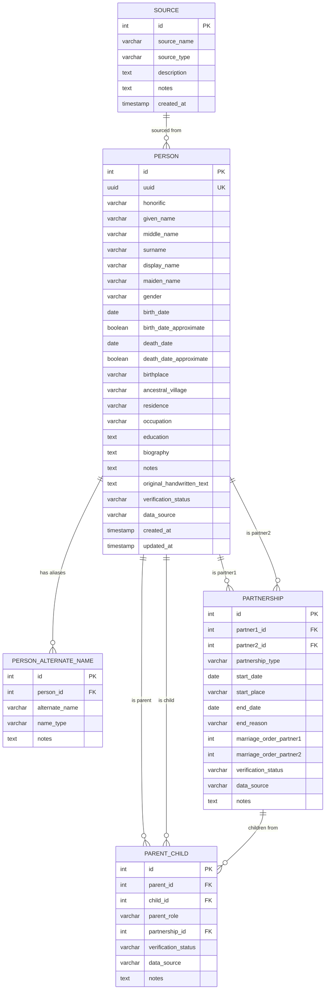
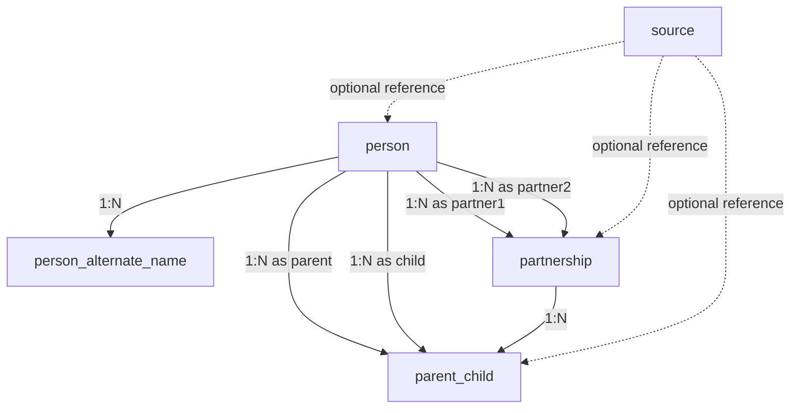

# Family Lineage Database Design — Phase 1

## Goal

Design a robust, normalized PostgreSQL database schema to store a multi-generational family lineage (6–10 generations, 200–500 individuals, primarily paternal lineage). The schema must support:

- Accurate parent-child and spousal relationships
- Incomplete, uncertain, or disputed data
- Duplicate/similar names across individuals
- Manual CSV-based data entry
- Future website features (interactive tree, search, filtering)

> [!NOTE]
> This is Phase 1 only — **database design**. No website, API, or UI code will be produced. Phase 2 begins after the user approves this schema.

---

## User Review Required

> [!IMPORTANT]
> **Design Decision: Separate relationship tables vs. embedded foreign keys**
> Parent-child and marriage relationships are stored in **dedicated junction tables** (`parent_child`, `partnership`) rather than as `father_id`/`mother_id` columns on the `person` table. This is more flexible (supports unknown parents, step-parents, adoptive parents, multiple marriages) but requires joining tables for common queries. **Please confirm you're comfortable with this approach.**

> [!IMPORTANT]
> **Design Decision: UUIDs vs. serial integer IDs**
> The plan uses **integer serial primary keys** (not UUIDs) for simplicity during CSV import and manual data entry. UUIDs are harder to type and reference by hand. A `uuid` column is included as a secondary unique identifier for future API use. **Please confirm this is acceptable.**

> [!IMPORTANT]
> **Design Decision: Alternate names table**
> Maiden names, aliases, and alternate spellings are stored in a separate `person_alternate_name` table rather than a single text field. This enables searching by any name variant. **Is this the right level of normalization for your needs, or would a simpler `aliases` text field suffice?**

> [!WARNING]
> **Ancestral village / location handling**: Locations (birthplace, ancestral village, residence) are stored as free-text fields on the `person` table, not in a separate `locations` table. This avoids complexity for initial data entry. If you later want to filter/group by location with standardized names, we can add a `location` lookup table in Phase 2.

---

## Open Questions

> [!IMPORTANT]
> **Q1**: Do you want to track **generation numbers** explicitly (e.g., generation 1 = earliest known ancestor)? This helps with tree visualization but requires you to assign a generation number to each person during data entry. Alternatively, generation can be computed dynamically from parent-child links.

> [!IMPORTANT]
> **Q2**: For the **paternal lineage focus** — should maternal parents still be recorded when known, or should the schema only enforce paternal links? (Recommendation: store both when known, enforce neither.)

> [!IMPORTANT]
> **Q3**: Do you want a **"family branch"** label (e.g., "Gupta – Varanasi branch", "Gupta – Delhi branch") as a tag on persons, or is this unnecessary?

---

## Entity-Relationship Diagram



---

## Proposed Schema — Table-by-Table

### Table 1: `person`

The central table. Each row is a **unique individual**. Names and biographical details live here. Relationships live in separate tables.

| Column | Type | Nullable | Default | Constraints | Notes |
|---|---|---|---|---|---|
| `id` | `SERIAL` | NO | auto | **PK** | Stable numeric identifier |
| `uuid` | `UUID` | NO | `gen_random_uuid()` | **UNIQUE** | For future API use |
| `honorific` | `VARCHAR(20)` | YES | | | Shri, Smt, Dr, Mr, Ms, etc. |
| `given_name` | `VARCHAR(100)` | NO | | | First / given name |
| `middle_name` | `VARCHAR(100)` | YES | | | |
| `surname` | `VARCHAR(100)` | YES | | | Family name / last name |
| `display_name` | `VARCHAR(255)` | YES | | | Full formatted name for display |
| `maiden_name` | `VARCHAR(100)` | YES | | | Pre-marriage surname if changed |
| `gender` | `VARCHAR(20)` | YES | | CHECK in (`'male'`, `'female'`, `'other'`, `'unknown'`) | Nullable for unknown |
| `birth_date` | `DATE` | YES | | | NULL if unknown |
| `birth_date_approximate` | `BOOLEAN` | NO | `FALSE` | | TRUE if date is estimated |
| `death_date` | `DATE` | YES | | | NULL if alive or unknown |
| `death_date_approximate` | `BOOLEAN` | NO | `FALSE` | | TRUE if date is estimated |
| `birthplace` | `VARCHAR(255)` | YES | | | Free text |
| `ancestral_village` | `VARCHAR(255)` | YES | | | Important for Indian family trees |
| `residence` | `VARCHAR(255)` | YES | | | Current or last known residence |
| `occupation` | `VARCHAR(255)` | YES | | | |
| `education` | `TEXT` | YES | | | Degrees, institutions |
| `biography` | `TEXT` | YES | | | Extended biographical notes |
| `notes` | `TEXT` | YES | | | General notes |
| `original_handwritten_text` | `TEXT` | YES | | | Preserve original handwritten notes verbatim |
| `verification_status` | `VARCHAR(20)` | NO | `'unverified'` | CHECK in (`'verified'`, `'unverified'`, `'disputed'`) | |
| `data_source` | `VARCHAR(255)` | YES | | | E.g., "handwritten tree", "oral – Uncle Ramesh" |
| `generation_number` | `INTEGER` | YES | | | Optional: 1 = earliest known ancestor |
| `created_at` | `TIMESTAMPTZ` | NO | `NOW()` | | |
| `updated_at` | `TIMESTAMPTZ` | NO | `NOW()` | | Auto-updated via trigger |

**Key design decisions:**
- `given_name` is the only required name field — everything else is nullable
- `display_name` is a convenience field you can populate as "Shri Ramesh Kumar Gupta" for display
- `original_handwritten_text` preserves raw handwritten notes so nothing is lost during digitization
- Dates are nullable because many historical family members will have unknown dates
- `birth_date_approximate` / `death_date_approximate` flags let you distinguish "born 1920" (exact) from "born ~1920" (estimated)

---

### Table 2: `person_alternate_name`

Stores aliases, alternate spellings, transliterations, and nicknames.

| Column | Type | Nullable | Default | Constraints | Notes |
|---|---|---|---|---|---|
| `id` | `SERIAL` | NO | auto | **PK** | |
| `person_id` | `INTEGER` | NO | | **FK → person(id)** ON DELETE CASCADE | |
| `alternate_name` | `VARCHAR(255)` | NO | | | The alternate name |
| `name_type` | `VARCHAR(50)` | YES | | CHECK in (`'alias'`, `'nickname'`, `'maiden_name'`, `'transliteration'`, `'spelling_variant'`, `'formal_name'`, `'other'`) | Categorize the alternate name |
| `notes` | `TEXT` | YES | | | |

**Why a separate table?** A person named "Ramesh" might also be known as "Ram", or have their name written as "रामेश" in Hindi. This table lets you search across all name variants.

---

### Table 3: `partnership`

Stores marriages and other partnerships between two people. Designed to handle multiple marriages.

| Column | Type | Nullable | Default | Constraints | Notes |
|---|---|---|---|---|---|
| `id` | `SERIAL` | NO | auto | **PK** | |
| `partner1_id` | `INTEGER` | NO | | **FK → person(id)** | By convention, the person entered first |
| `partner2_id` | `INTEGER` | NO | | **FK → person(id)** | |
| `partnership_type` | `VARCHAR(30)` | NO | `'marriage'` | CHECK in (`'marriage'`, `'partnership'`, `'engagement'`, `'other'`, `'unknown'`) | |
| `start_date` | `DATE` | YES | | | Marriage/partnership date |
| `start_place` | `VARCHAR(255)` | YES | | | Where the marriage took place |
| `end_date` | `DATE` | YES | | | Divorce/death date if applicable |
| `end_reason` | `VARCHAR(50)` | YES | | CHECK in (`'death'`, `'divorce'`, `'annulment'`, `'separation'`, `'other'`, `NULL`) | |
| `marriage_order_partner1` | `INTEGER` | YES | | | 1st marriage, 2nd marriage, etc. for partner1 |
| `marriage_order_partner2` | `INTEGER` | YES | | | 1st marriage, 2nd marriage, etc. for partner2 |
| `verification_status` | `VARCHAR(20)` | NO | `'unverified'` | CHECK in (`'verified'`, `'unverified'`, `'disputed'`) | |
| `data_source` | `VARCHAR(255)` | YES | | | |
| `notes` | `TEXT` | YES | | | |

**Constraints:**
- `CHECK (partner1_id <> partner2_id)` — prevents self-marriage
- `UNIQUE (partner1_id, partner2_id, COALESCE(start_date, '1000-01-01'))` — prevents duplicate identical partnerships (uses a sentinel date for NULL start_date cases)

**How multiple marriages work:** If person A marries person B and later person C, there will be two rows in `partnership` — one for A-B and one for A-C. The `marriage_order_*` columns record which marriage came first.

---

### Table 4: `parent_child`

The core relationship table. Links a parent to a child. Each child can have up to two parent rows (father + mother), but the schema doesn't enforce exactly two.

| Column | Type | Nullable | Default | Constraints | Notes |
|---|---|---|---|---|---|
| `id` | `SERIAL` | NO | auto | **PK** | |
| `parent_id` | `INTEGER` | NO | | **FK → person(id)** | |
| `child_id` | `INTEGER` | NO | | **FK → person(id)** | |
| `parent_role` | `VARCHAR(30)` | NO | `'biological'` | CHECK in (`'biological'`, `'adoptive'`, `'step'`, `'guardian'`, `'unknown'`) | |
| `partnership_id` | `INTEGER` | YES | | **FK → partnership(id)** | Links child to a specific marriage (nullable if unknown) |
| `birth_order` | `INTEGER` | YES | | | 1 = firstborn from this parent, etc. |
| `verification_status` | `VARCHAR(20)` | NO | `'unverified'` | CHECK in (`'verified'`, `'unverified'`, `'disputed'`) | |
| `data_source` | `VARCHAR(255)` | YES | | | |
| `notes` | `TEXT` | YES | | | |

**Constraints:**
- `CHECK (parent_id <> child_id)` — prevents self-parenting
- `UNIQUE (parent_id, child_id)` — prevents duplicate parent-child links

**How half-siblings work:** If father A has children with spouse B and later spouse C:
- Children from marriage 1: `parent_child` rows link to partnership A-B
- Children from marriage 2: `parent_child` rows link to partnership A-C
- Half-siblings share one parent but reference different partnerships

**How unknown parents work:** If only the father is known, only one `parent_child` row exists (for the father). The mother row simply doesn't exist — no NULLs, no placeholders.

---

### Table 5: `source`

Optional reference table for data provenance. Useful if you want to centralize source descriptions rather than repeating free-text `data_source` values.

| Column | Type | Nullable | Default | Constraints | Notes |
|---|---|---|---|---|---|
| `id` | `SERIAL` | NO | auto | **PK** | |
| `source_name` | `VARCHAR(255)` | NO | | UNIQUE | E.g., "Handwritten Family Tree (2024)" |
| `source_type` | `VARCHAR(50)` | YES | | CHECK in (`'handwritten_document'`, `'oral_account'`, `'official_document'`, `'photograph'`, `'online_record'`, `'other'`) | |
| `description` | `TEXT` | YES | | | |
| `notes` | `TEXT` | YES | | | |
| `created_at` | `TIMESTAMPTZ` | NO | `NOW()` | | |

> [!TIP]
> The `data_source` text field on `person`, `parent_child`, and `partnership` is sufficient for Phase 1. The `source` table is optional — you can populate it later and link records to it via a foreign key added in a future migration.

---

## Relationships & Constraints Summary



| Relationship | Type | Explanation |
|---|---|---|
| Person → Alternate Names | One-to-Many | A person can have 0..N alternate names |
| Person → Parent-Child (as parent) | One-to-Many | A person can be parent to 0..N children |
| Person → Parent-Child (as child) | One-to-Many | A person can have 0..2 recorded parents (typically), but the schema allows more for edge cases (step-parents) |
| Person → Partnership (as partner) | One-to-Many | A person can have 0..N partnerships |
| Partnership → Parent-Child | One-to-Many | A partnership can have 0..N children associated with it |
| Source → various | One-to-Many (optional) | A source can be referenced by many records |

### Prevention of Invalid Data

| Rule | How Enforced |
|---|---|
| No self-parenting | `CHECK (parent_id <> child_id)` on `parent_child` |
| No self-marriage | `CHECK (partner1_id <> partner2_id)` on `partnership` |
| No duplicate parent-child links | `UNIQUE (parent_id, child_id)` on `parent_child` |
| No duplicate persons (by ID) | `SERIAL PK` auto-increments; `UUID` is unique |
| Circular ancestry prevention | Cannot be fully enforced at the DB level; use application-level validation in Phase 2. A CHECK trigger or recursive CTE check can be added. |
| Referential integrity | All FKs enforce `REFERENCES ... ON DELETE RESTRICT` (default) — you can't delete a person who has relationships |

### Nullable Fields Rationale

| Field | Why Nullable |
|---|---|
| `middle_name`, `surname` | Many historical individuals have only a given name |
| `maiden_name` | Only applicable when surname changed at marriage |
| `gender` | May be unknown for distant ancestors |
| `birth_date`, `death_date` | Unknown for most historical individuals |
| `birthplace`, `ancestral_village`, `residence` | Often unknown |
| `occupation`, `education`, `biography` | Supplementary information, not always available |
| `partnership_id` on `parent_child` | The specific marriage a child belongs to may be unknown |
| `start_date`, `end_date` on `partnership` | Marriage dates are often unknown for older generations |

### Recommended Indexes

| Index | Purpose |
|---|---|
| `idx_person_given_name` on `person(given_name)` | Name search |
| `idx_person_surname` on `person(surname)` | Name search |
| `idx_person_display_name` on `person(display_name)` | Display name search |
| `idx_person_alternate_name` on `person_alternate_name(alternate_name)` | Alias search |
| `idx_parent_child_parent` on `parent_child(parent_id)` | Find children of a parent |
| `idx_parent_child_child` on `parent_child(child_id)` | Find parents of a child |
| `idx_partnership_partner1` on `partnership(partner1_id)` | Find partnerships |
| `idx_partnership_partner2` on `partnership(partner2_id)` | Find partnerships |
| `idx_person_ancestral_village` on `person(ancestral_village)` | Location filtering |
| `idx_person_generation` on `person(generation_number)` | Generation filtering |

---

## PostgreSQL DDL

```sql
-- ============================================================
-- Family Lineage Database — PostgreSQL DDL
-- Phase 1: Schema Creation
-- ============================================================

-- Enable UUID generation
CREATE EXTENSION IF NOT EXISTS "pgcrypto";

-- ============================================================
-- Table: source (optional, create first since others may reference it)
-- ============================================================
CREATE TABLE source (
    id              SERIAL PRIMARY KEY,
    source_name     VARCHAR(255) NOT NULL UNIQUE,
    source_type     VARCHAR(50) CHECK (source_type IN (
                        'handwritten_document', 'oral_account',
                        'official_document', 'photograph',
                        'online_record', 'other'
                    )),
    description     TEXT,
    notes           TEXT,
    created_at      TIMESTAMPTZ NOT NULL DEFAULT NOW()
);

-- ============================================================
-- Table: person
-- ============================================================
CREATE TABLE person (
    id                      SERIAL PRIMARY KEY,
    uuid                    UUID NOT NULL DEFAULT gen_random_uuid() UNIQUE,
    honorific               VARCHAR(20),
    given_name              VARCHAR(100) NOT NULL,
    middle_name             VARCHAR(100),
    surname                 VARCHAR(100),
    display_name            VARCHAR(255),
    maiden_name             VARCHAR(100),
    gender                  VARCHAR(20) CHECK (gender IN (
                                'male', 'female', 'other', 'unknown'
                            )),
    birth_date              DATE,
    birth_date_approximate  BOOLEAN NOT NULL DEFAULT FALSE,
    death_date              DATE,
    death_date_approximate  BOOLEAN NOT NULL DEFAULT FALSE,
    birthplace              VARCHAR(255),
    ancestral_village       VARCHAR(255),
    residence               VARCHAR(255),
    occupation              VARCHAR(255),
    education               TEXT,
    biography               TEXT,
    notes                   TEXT,
    original_handwritten_text TEXT,
    verification_status     VARCHAR(20) NOT NULL DEFAULT 'unverified'
                            CHECK (verification_status IN (
                                'verified', 'unverified', 'disputed'
                            )),
    data_source             VARCHAR(255),
    generation_number       INTEGER,
    created_at              TIMESTAMPTZ NOT NULL DEFAULT NOW(),
    updated_at              TIMESTAMPTZ NOT NULL DEFAULT NOW(),

    -- Validate death is not before birth
    CONSTRAINT chk_dates CHECK (
        birth_date IS NULL OR death_date IS NULL OR death_date >= birth_date
    )
);

-- Auto-update updated_at
CREATE OR REPLACE FUNCTION update_updated_at_column()
RETURNS TRIGGER AS $$
BEGIN
    NEW.updated_at = NOW();
    RETURN NEW;
END;
$$ LANGUAGE plpgsql;

CREATE TRIGGER trg_person_updated_at
    BEFORE UPDATE ON person
    FOR EACH ROW
    EXECUTE FUNCTION update_updated_at_column();

-- ============================================================
-- Table: person_alternate_name
-- ============================================================
CREATE TABLE person_alternate_name (
    id              SERIAL PRIMARY KEY,
    person_id       INTEGER NOT NULL REFERENCES person(id) ON DELETE CASCADE,
    alternate_name  VARCHAR(255) NOT NULL,
    name_type       VARCHAR(50) CHECK (name_type IN (
                        'alias', 'nickname', 'maiden_name',
                        'transliteration', 'spelling_variant',
                        'formal_name', 'other'
                    )),
    notes           TEXT
);

-- ============================================================
-- Table: partnership
-- ============================================================
CREATE TABLE partnership (
    id                      SERIAL PRIMARY KEY,
    partner1_id             INTEGER NOT NULL REFERENCES person(id),
    partner2_id             INTEGER NOT NULL REFERENCES person(id),
    partnership_type        VARCHAR(30) NOT NULL DEFAULT 'marriage'
                            CHECK (partnership_type IN (
                                'marriage', 'partnership', 'engagement',
                                'other', 'unknown'
                            )),
    start_date              DATE,
    start_place             VARCHAR(255),
    end_date                DATE,
    end_reason              VARCHAR(50) CHECK (end_reason IN (
                                'death', 'divorce', 'annulment',
                                'separation', 'other'
                            )),
    marriage_order_partner1 INTEGER,
    marriage_order_partner2 INTEGER,
    verification_status     VARCHAR(20) NOT NULL DEFAULT 'unverified'
                            CHECK (verification_status IN (
                                'verified', 'unverified', 'disputed'
                            )),
    data_source             VARCHAR(255),
    notes                   TEXT,

    -- Prevent self-marriage
    CONSTRAINT chk_no_self_marriage CHECK (partner1_id <> partner2_id),

    -- Prevent exact duplicate partnerships
    CONSTRAINT uq_partnership UNIQUE (partner1_id, partner2_id, COALESCE(start_date, '1000-01-01'))
);

-- ============================================================
-- Table: parent_child
-- ============================================================
CREATE TABLE parent_child (
    id                  SERIAL PRIMARY KEY,
    parent_id           INTEGER NOT NULL REFERENCES person(id),
    child_id            INTEGER NOT NULL REFERENCES person(id),
    parent_role         VARCHAR(30) NOT NULL DEFAULT 'biological'
                        CHECK (parent_role IN (
                            'biological', 'adoptive', 'step',
                            'guardian', 'unknown'
                        )),
    partnership_id      INTEGER REFERENCES partnership(id),
    birth_order         INTEGER,
    verification_status VARCHAR(20) NOT NULL DEFAULT 'unverified'
                        CHECK (verification_status IN (
                            'verified', 'unverified', 'disputed'
                        )),
    data_source         VARCHAR(255),
    notes               TEXT,

    -- Prevent self-parenting
    CONSTRAINT chk_no_self_parent CHECK (parent_id <> child_id),

    -- Prevent duplicate parent-child relationships
    CONSTRAINT uq_parent_child UNIQUE (parent_id, child_id)
);

-- ============================================================
-- Indexes
-- ============================================================
CREATE INDEX idx_person_given_name ON person(given_name);
CREATE INDEX idx_person_surname ON person(surname);
CREATE INDEX idx_person_display_name ON person(display_name);
CREATE INDEX idx_person_ancestral_village ON person(ancestral_village);
CREATE INDEX idx_person_generation ON person(generation_number);

CREATE INDEX idx_alt_name_person ON person_alternate_name(person_id);
CREATE INDEX idx_alt_name_name ON person_alternate_name(alternate_name);

CREATE INDEX idx_parent_child_parent ON parent_child(parent_id);
CREATE INDEX idx_parent_child_child ON parent_child(child_id);
CREATE INDEX idx_parent_child_partnership ON parent_child(partnership_id);

CREATE INDEX idx_partnership_partner1 ON partnership(partner1_id);
CREATE INDEX idx_partnership_partner2 ON partnership(partner2_id);
```

---

## Sample Data (Fictional)

> [!NOTE]
> All names below are **entirely fictional** and do not represent real people. They demonstrate how to insert records for a multi-generational family.

### Fictional Family Structure

```
Generation 1: Shri Bhagwan Das Sharma (m. Smt Savitri Devi)
  └── Generation 2: Shri Ramesh Kumar Sharma (m. Smt Sunita Verma)
        ├── Generation 3: Dr Anil Sharma (m. Priya Singh)
        │     └── Generation 4: Rohan Sharma
        └── Generation 3: Smt Kavita Sharma (m. Suresh Gupta)
              └── Generation 4: Neha Gupta
```

### SQL INSERT Statements

```sql
-- ============================================================
-- STEP 1: Insert source (optional)
-- ============================================================
INSERT INTO source (source_name, source_type, description)
VALUES ('Handwritten Family Tree (2024)', 'handwritten_document',
        'Paper family tree maintained by the family patriarch');

-- ============================================================
-- STEP 2: Insert persons (oldest generation first)
-- ============================================================

-- Generation 1
INSERT INTO person (id, honorific, given_name, surname, display_name,
                    gender, birth_date, birth_date_approximate, death_date,
                    ancestral_village, occupation, generation_number,
                    data_source, verification_status)
VALUES
(1, 'Shri', 'Bhagwan Das', 'Sharma', 'Shri Bhagwan Das Sharma',
 'male', '1920-01-01', TRUE, '1995-06-15',
 'Ramnagar', 'Farmer', 1,
 'Handwritten Family Tree (2024)', 'unverified'),

(2, 'Smt', 'Savitri', 'Devi', 'Smt Savitri Devi',
 'female', NULL, FALSE, '2000-03-10',
 'Ramnagar', NULL, 1,
 'Handwritten Family Tree (2024)', 'unverified');

-- Generation 2
INSERT INTO person (id, honorific, given_name, middle_name, surname,
                    display_name, gender, birth_date,
                    ancestral_village, occupation, generation_number,
                    data_source)
VALUES
(3, 'Shri', 'Ramesh', 'Kumar', 'Sharma', 'Shri Ramesh Kumar Sharma',
 'male', '1950-05-20',
 'Ramnagar', 'Government Officer', 2,
 'Handwritten Family Tree (2024)'),

(4, 'Smt', 'Sunita', NULL, 'Sharma', 'Smt Sunita Sharma',
 'female', '1955-08-12',
 'Lucknow', 'Teacher', 2,
 'Handwritten Family Tree (2024)');

-- Record Sunita's maiden name
UPDATE person SET maiden_name = 'Verma' WHERE id = 4;

-- Generation 3
INSERT INTO person (id, honorific, given_name, surname, display_name,
                    gender, birth_date, occupation, education,
                    generation_number, data_source)
VALUES
(5, 'Dr', 'Anil', 'Sharma', 'Dr Anil Sharma',
 'male', '1978-11-03', 'Doctor', 'MBBS, AIIMS Delhi', 3,
 'Handwritten Family Tree (2024)'),

(6, NULL, 'Priya', 'Sharma', 'Priya Sharma',
 'female', '1980-02-14', 'Software Engineer', 'B.Tech, IIT Kanpur', 3,
 'Handwritten Family Tree (2024)'),

(7, 'Smt', 'Kavita', 'Gupta', 'Smt Kavita Gupta',
 'female', '1982-07-22', 'Homemaker', NULL, 3,
 'Handwritten Family Tree (2024)'),

(8, NULL, 'Suresh', 'Gupta', 'Suresh Gupta',
 'male', '1979-09-08', 'Businessman', NULL, 3,
 'Handwritten Family Tree (2024)');

-- Record Kavita's maiden name and Priya's maiden name
UPDATE person SET maiden_name = 'Sharma' WHERE id = 7;
UPDATE person SET maiden_name = 'Singh' WHERE id = 6;

-- Generation 4
INSERT INTO person (id, given_name, surname, display_name,
                    gender, birth_date, generation_number, data_source)
VALUES
(9, 'Rohan', 'Sharma', 'Rohan Sharma',
 'male', '2005-01-30', 4,
 'Handwritten Family Tree (2024)'),

(10, 'Neha', 'Gupta', 'Neha Gupta',
 'female', '2008-12-05', 4,
 'Handwritten Family Tree (2024)');

-- ============================================================
-- STEP 3: Insert alternate names
-- ============================================================
INSERT INTO person_alternate_name (person_id, alternate_name, name_type, notes)
VALUES
(1, 'B.D. Sharma', 'alias', 'Initials used in official documents'),
(2, 'Savitri Sharma', 'spelling_variant', 'Sometimes referred to with husband surname'),
(6, 'Priya Singh', 'maiden_name', 'Name before marriage');

-- ============================================================
-- STEP 4: Insert partnerships (marriages)
-- ============================================================
INSERT INTO partnership (id, partner1_id, partner2_id, partnership_type,
                         start_date, start_place, marriage_order_partner1,
                         marriage_order_partner2, data_source)
VALUES
(1, 1, 2, 'marriage', '1945-04-10', 'Ramnagar', 1, 1,
 'Handwritten Family Tree (2024)'),

(2, 3, 4, 'marriage', '1975-02-15', 'Lucknow', 1, 1,
 'Handwritten Family Tree (2024)'),

(3, 5, 6, 'marriage', '2004-11-20', 'Delhi', 1, 1,
 'Handwritten Family Tree (2024)'),

(4, 8, 7, 'marriage', '2005-06-08', 'Varanasi', 1, 1,
 'Handwritten Family Tree (2024)');

-- ============================================================
-- STEP 5: Insert parent-child relationships
-- ============================================================

-- Bhagwan Das & Savitri → Ramesh
INSERT INTO parent_child (parent_id, child_id, parent_role, partnership_id,
                          birth_order, data_source)
VALUES
(1, 3, 'biological', 1, 1, 'Handwritten Family Tree (2024)'),
(2, 3, 'biological', 1, 1, 'Handwritten Family Tree (2024)');

-- Ramesh & Sunita → Anil, Kavita
INSERT INTO parent_child (parent_id, child_id, parent_role, partnership_id,
                          birth_order, data_source)
VALUES
(3, 5, 'biological', 2, 1, 'Handwritten Family Tree (2024)'),
(4, 5, 'biological', 2, 1, 'Handwritten Family Tree (2024)'),
(3, 7, 'biological', 2, 2, 'Handwritten Family Tree (2024)'),
(4, 7, 'biological', 2, 2, 'Handwritten Family Tree (2024)');

-- Anil & Priya → Rohan
INSERT INTO parent_child (parent_id, child_id, parent_role, partnership_id,
                          birth_order, data_source)
VALUES
(5, 9, 'biological', 3, 1, 'Handwritten Family Tree (2024)'),
(6, 9, 'biological', 3, 1, 'Handwritten Family Tree (2024)');

-- Suresh & Kavita → Neha
INSERT INTO parent_child (parent_id, child_id, parent_role, partnership_id,
                          birth_order, data_source)
VALUES
(8, 10, 'biological', 4, 1, 'Handwritten Family Tree (2024)'),
(7, 10, 'biological', 4, 1, 'Handwritten Family Tree (2024)');

-- Reset sequences after manual ID inserts
SELECT setval('person_id_seq', (SELECT MAX(id) FROM person));
SELECT setval('partnership_id_seq', (SELECT MAX(id) FROM partnership));
SELECT setval('parent_child_id_seq', (SELECT MAX(id) FROM parent_child));
```

---

## Useful Queries for the Future Website

These queries demonstrate how the schema supports the website features listed in the requirements.

```sql
-- Find all children of a person
SELECT c.* FROM person c
JOIN parent_child pc ON pc.child_id = c.id
WHERE pc.parent_id = 3;  -- Ramesh's children

-- Find parents of a person
SELECT p.* FROM person p
JOIN parent_child pc ON pc.parent_id = p.id
WHERE pc.child_id = 5;  -- Anil's parents

-- Find spouse(s) of a person
SELECT CASE WHEN p.partner1_id = 3 THEN p.partner2_id ELSE p.partner1_id END AS spouse_id,
       sp.display_name, p.partnership_type, p.start_date
FROM partnership p
JOIN person sp ON sp.id = CASE WHEN p.partner1_id = 3 THEN p.partner2_id ELSE p.partner1_id END
WHERE p.partner1_id = 3 OR p.partner2_id = 3;

-- Find siblings (share at least one parent)
SELECT DISTINCT sibling.* FROM person sibling
JOIN parent_child pc_sibling ON pc_sibling.child_id = sibling.id
JOIN parent_child pc_self ON pc_self.parent_id = pc_sibling.parent_id
WHERE pc_self.child_id = 5  -- Anil's siblings
  AND sibling.id <> 5;

-- Search by name or alternate name
SELECT DISTINCT p.* FROM person p
LEFT JOIN person_alternate_name pan ON pan.person_id = p.id
WHERE p.given_name ILIKE '%ramesh%'
   OR p.surname ILIKE '%ramesh%'
   OR p.display_name ILIKE '%ramesh%'
   OR pan.alternate_name ILIKE '%ramesh%';

-- Get all people in a specific generation
SELECT * FROM person WHERE generation_number = 2;

-- Get entire family tree as adjacency list (for tree rendering)
SELECT pc.parent_id, pp.display_name AS parent_name,
       pc.child_id, cp.display_name AS child_name,
       pc.parent_role, pc.birth_order
FROM parent_child pc
JOIN person pp ON pp.id = pc.parent_id
JOIN person cp ON cp.id = pc.child_id
ORDER BY pp.generation_number, pc.birth_order;

-- Recursive CTE: find all descendants of a person
WITH RECURSIVE descendants AS (
    SELECT child_id, 1 AS depth
    FROM parent_child WHERE parent_id = 1  -- Bhagwan Das
    UNION ALL
    SELECT pc.child_id, d.depth + 1
    FROM parent_child pc
    JOIN descendants d ON d.child_id = pc.parent_id
)
SELECT DISTINCT p.*, d.depth FROM person p
JOIN descendants d ON d.child_id = p.id
ORDER BY d.depth;
```

---

## How the Schema Supports Future Website Features

| Website Feature | Schema Support |
|---|---|
| **Interactive family tree** | `parent_child` table provides the tree edges; recursive CTEs traverse generations; `person.generation_number` aids vertical positioning |
| **Navigate ancestors ↔ descendants** | Recursive CTEs on `parent_child` walk up (find parents) or down (find children) |
| **View spouses and children** | `partnership` table links spouses; `parent_child.partnership_id` associates children with marriages |
| **Expand/collapse generations** | `generation_number` enables level-by-level loading |
| **Person profile page** | All biographical fields on `person` table; join with `person_alternate_name`, `partnership`, `parent_child` for complete profile |
| **Search by name** | Indexes on `given_name`, `surname`, `display_name`; `person_alternate_name` table enables alias search |
| **Filter by generation/location** | `generation_number` and `ancestral_village` columns with indexes |
| **Show uncertain relationships** | `verification_status` on every relationship table; UI can render dotted/dashed lines |
| **Add/correct records** | Nullable fields, `updated_at` trigger, and separate relationship tables allow incremental edits |
| **Export for backup** | Standard SQL `COPY` / `pg_dump` works with this normalized structure |
| **Media (future)** | Add a `person_media` table with FK to `person.id` — no schema changes needed to existing tables |

---

## CSV Data-Entry Templates

Use these CSV templates to prepare data before importing. Import in the order listed below.

### Recommended Data Entry Order

1. **`person.csv`** — Enter all individuals first, starting from the oldest generation
2. **`person_alternate_name.csv`** — Enter alternate names/aliases
3. **`partnership.csv`** — Enter marriages (both partners must exist in `person` first)
4. **`parent_child.csv`** — Enter parent-child links (all persons and partnerships must exist first)
5. **`source.csv`** — Optional: enter sources at any time

### Template: `person.csv`

```csv
id,honorific,given_name,middle_name,surname,display_name,maiden_name,gender,birth_date,birth_date_approximate,death_date,death_date_approximate,birthplace,ancestral_village,residence,occupation,education,biography,notes,original_handwritten_text,verification_status,data_source,generation_number
1,Shri,Bhagwan Das,,Sharma,Shri Bhagwan Das Sharma,,male,1920-01-01,TRUE,1995-06-15,FALSE,,Ramnagar,,Farmer,,,,,unverified,Handwritten Family Tree (2024),1
2,Smt,Savitri,,Devi,Smt Savitri Devi,,female,,,FALSE,2000-03-10,FALSE,,Ramnagar,,,,,,unverified,Handwritten Family Tree (2024),1
```

### Template: `person_alternate_name.csv`

```csv
id,person_id,alternate_name,name_type,notes
1,1,B.D. Sharma,alias,Initials used in official documents
2,2,Savitri Sharma,spelling_variant,Sometimes referred to with husband surname
```

### Template: `partnership.csv`

```csv
id,partner1_id,partner2_id,partnership_type,start_date,start_place,end_date,end_reason,marriage_order_partner1,marriage_order_partner2,verification_status,data_source,notes
1,1,2,marriage,1945-04-10,Ramnagar,,,1,1,unverified,Handwritten Family Tree (2024),
```

### Template: `parent_child.csv`

```csv
id,parent_id,child_id,parent_role,partnership_id,birth_order,verification_status,data_source,notes
1,1,3,biological,1,1,unverified,Handwritten Family Tree (2024),
2,2,3,biological,1,1,unverified,Handwritten Family Tree (2024),
```

### Template: `source.csv`

```csv
id,source_name,source_type,description,notes
1,Handwritten Family Tree (2024),handwritten_document,Paper family tree maintained by the family patriarch,
```

### PostgreSQL COPY Commands for Import

```sql
-- Import in this order:
\copy source FROM 'source.csv' WITH (FORMAT csv, HEADER true, NULL '');
\copy person FROM 'person.csv' WITH (FORMAT csv, HEADER true, NULL '');
\copy person_alternate_name FROM 'person_alternate_name.csv' WITH (FORMAT csv, HEADER true, NULL '');
\copy partnership FROM 'partnership.csv' WITH (FORMAT csv, HEADER true, NULL '');
\copy parent_child FROM 'parent_child.csv' WITH (FORMAT csv, HEADER true, NULL '');

-- After import, reset sequences:
SELECT setval('person_id_seq', (SELECT MAX(id) FROM person));
SELECT setval('person_alternate_name_id_seq', (SELECT MAX(id) FROM person_alternate_name));
SELECT setval('partnership_id_seq', (SELECT MAX(id) FROM partnership));
SELECT setval('parent_child_id_seq', (SELECT MAX(id) FROM parent_child));
SELECT setval('source_id_seq', (SELECT MAX(id) FROM source));
```

---

## Validation Rules for Manual Data Entry

Follow these rules while converting your handwritten chart to ensure data integrity:

| # | Rule | Rationale |
|---|---|---|
| 1 | **Assign unique IDs sequentially** starting from 1. Never reuse an ID. | Prevents FK conflicts |
| 2 | **Enter all `person` records before relationships.** | FKs require referenced records to exist |
| 3 | **Enter partnerships before `parent_child` rows** that reference them. | `partnership_id` FK must exist |
| 4 | **One row per person** — never create two rows for the same person. | Use `person_alternate_name` for aliases |
| 5 | **Use consistent IDs.** If Ramesh is ID 3, always reference 3. | Prevents orphaned relationships |
| 6 | **Leave unknown fields empty** (blank in CSV = NULL in DB). Never invent data. | Preserves accuracy |
| 7 | **Set `birth_date_approximate = TRUE`** when a date is estimated. | Distinguishes exact from guessed dates |
| 8 | **Two `parent_child` rows per child** when both parents are known (one for father, one for mother). | Each row links one parent to one child |
| 9 | **Check `partner1_id < partner2_id`** in partnerships (convention). | Helps avoid accidentally creating duplicate partnerships in reverse order |
| 10 | **Verify no person is listed as their own parent** — `parent_id ≠ child_id`. | DB constraint will reject this, but catch it early |
| 11 | **Record the `original_handwritten_text`** for any person whose handwritten entry is ambiguous. | Preserves the source for later review |
| 12 | **Mark `verification_status = 'disputed'`** for any relationship or fact you are unsure about. | Helps prioritize what to verify later |
| 13 | **Use `generation_number` consistently**: 1 = earliest ancestor, incrementing downward. | Enables generation-based queries and visualization |

---

## Verification Plan

### Automated Tests (Phase 2)
Once the database is created, we will run:
```bash
# Create the database and apply schema
psql -U postgres -c "CREATE DATABASE family_lineage;"
psql -U postgres -d family_lineage -f schema.sql

# Insert sample data
psql -U postgres -d family_lineage -f sample_data.sql

# Run validation queries
psql -U postgres -d family_lineage -f validation_queries.sql
```

The validation queries will verify:
- All constraints are enforced (try inserting invalid data — expect rejection)
- Sample queries return expected results
- Indexes exist and are used in query plans

### Manual Verification
- Review the ER diagram for correctness
- Trace the fictional family through all tables to verify relationships
- Confirm CSV templates import cleanly
- Attempt edge cases: person with no parents, person with unknown gender, person with two marriages

---

## Design Decisions Requiring Your Approval

Before proceeding to Phase 2, please confirm:

1. ✅ or ❌ — **Separate relationship tables** (parent_child, partnership) instead of father_id/mother_id on person
2. ✅ or ❌ — **Integer serial IDs** for manual entry, with UUID as secondary identifier
3. ✅ or ❌ — **Separate `person_alternate_name` table** for aliases and spelling variants
4. ✅ or ❌ — **Locations as free-text fields** (not a separate locations table) for Phase 1
5. ✅ or ❌ — **`source` table is optional** in Phase 1 (data_source text field is sufficient for now)
6. ✅ or ❌ — **`generation_number` as a manually assigned column** (vs. computed dynamically)
7. ✅ or ❌ — **No media table** in Phase 1 (added in Phase 2 when needed)
